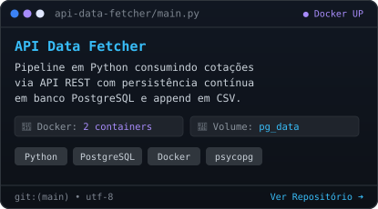
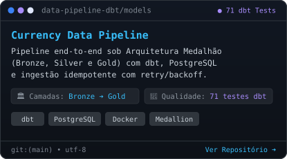
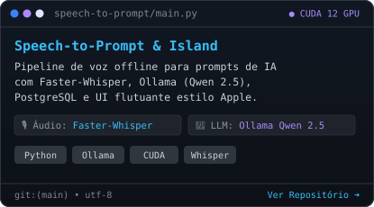
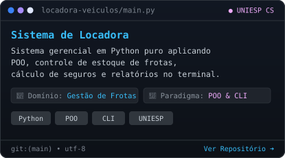

<h3><code>danilo@github ~ $ whoami</code></h3>

  
  

 

<h3><code>danilo@github ~ $ ./contributions.sh</code></h3>

  

<h3><code>danilo@github ~ $ cat stack.md</code></h3>

  

 

<h3><code>danilo@github ~ $ cat projects.md</code></h3>

  
  

  
  

 

  
  

