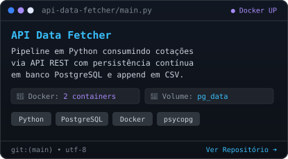
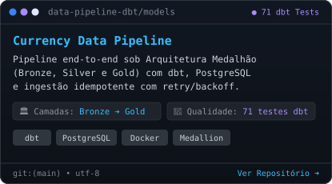
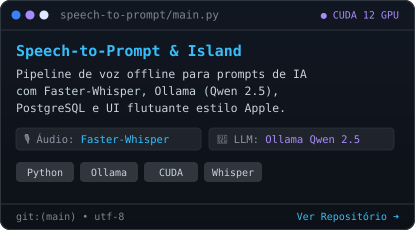
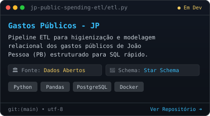

<div align="center">

<h3><code>danilo@github ~ $ whoami</code></h3>

<p align="center">
  
  
</p>

<br>

<h3><code>danilo@github ~ $ cat ~/about.txt</code></h3>

```text
.-----------------------------------------------------------------------------.
| (x) (-) (+)                     ~/about.txt                                 |
|-----------------------------------------------------------------------------|
|                                                                             |
| Estudante de Ciência da Computação @ UNIESP (João Pessoa, PB).              |
| Foco prático em Engenharia de Dados, Analytics e Backend com Python.        |
|                                                                             |
| Construo pipelines automatizados com Docker Compose, PostgreSQL e dbt,      |
| além de soluções locais de IA com Ollama e Faster-Whisper.                  |
|                                                                             |
| -@daniloofrs                                                                |
'-----------------------------------------------------------------------------'
```

<br>

<h3><code>danilo@github ~ $ ./contributions.sh</code></h3>



<br><br>

<h3><code>danilo@github ~ $ cat stack.md</code></h3>

<p align="center">
  
</p>

<br>

<h3><code>danilo@github ~ $ cat projects.md</code></h3>

<p align="center">
  <a href="https://github.com/daniloofrs/api-data-fetcher">
    
  </a>
  <a href="https://github.com/daniloofrs/data-pipeline-dbt">
    
  </a>
</p>

<p align="center">
  <a href="https://github.com/daniloofrs/speech-to-prompt-pipeline">
    
  </a>
  <a href="https://github.com/daniloofrs/jp-public-spending-etl">
    
  </a>
</p>

<br>

<p align="center">
  <a href="https://linkedin.com/in/daniloofrs"></a>
  <a href="https://github.com/daniloofrs/linkedin-agent/raw/main/resumes/pt-br/curriculo.pdf"></a>
  <a href="mailto:danilofernandes10a@gmail.com"></a>
</p>

<br>

```text
danilo@github ~ $ exit
logout
Saving session...completed.

[Process completed]▌
```

</div>
