<h3><code>danilo@github ~ $ whoami</code></h3>

  
  

 

<h3><code>danilo@github ~ $ ./contributions.sh</code></h3>

  

<h3><code>danilo@github ~ $ cat stack.md</code></h3>

  

 

<h3><code>danilo@github ~ $ cat projects.md</code></h3>

| Projeto | Stack |
| :--- | :--- |
| [**API Data Fetcher**](https://github.com/daniloofrs/api-data-fetcher) | `Python`, `PostgreSQL`, `Docker Compose`, `psycopg` |
| [**Raio-X dos Gastos Públicos de João Pessoa**](https://github.com/daniloofrs/jp-public-spending-etl) *(Em dev)* | `Python`, `Pandas`, `PostgreSQL`, `Docker` |

 

  
  

